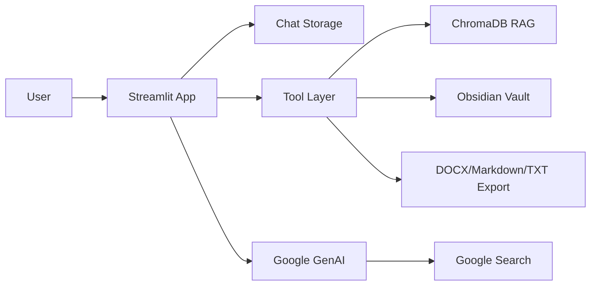
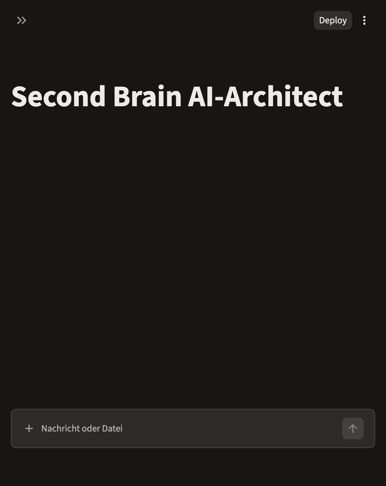

# Second Brain AI-Architect

Lokale, browserbasierte Second-Brain-Anwendung auf macOS. Sie kombiniert Gemini,
semantische Obsidian-Suche, Google-Suche und Human-in-the-Loop Write-Back.

## Architektur



## Features

- Inkrementeller Obsidian-Markdown-Sync mit Metadaten und Smart Chunking
- Lokale Persistenz in ChromaDB mit `gemini-embedding-001`
- Semantische Vault-Suche mit optionalem Ordnerfilter
- Human-in-the-Loop Notiz-Speicherung
- Chat-Historie als lokale JSON-Dateien
- Streamlit-UI mit Fokus-Auswahl und Multimodal-Uploads
- DOCX-, Markdown- und TXT-Export

## Screenshot



## Installation

Python 3.11+ wird unterstützt.

```bash
python3.13 -m venv .venv
source .venv/bin/activate
python -m pip install -r requirements.txt
```

Trage in `.env` die lokale Konfiguration ein:

```dotenv
GEMINI_API_KEY=
GEMINI_MODEL="gemini-2.5-flash"
OBSIDIAN_VAULT_PATH="/Pfad/zum/Second Brain"
DEFAULT_SAVE_FOLDER="System_Engineering"
```

## Start

```bash
streamlit run src/app.py
```

Die Anwendung läuft ohne API-Key im lokalen Mock-Modus.

## Mock-Tests

```bash
.venv/bin/python src/ingest.py --mock
.venv/bin/python -m src.exporter --mock
.venv/bin/python -m src.tools --mock
.venv/bin/python -m src.chat_storage --mock
```

## Datenschutz

`.env`, `.venv`, `chroma_db`, `chats`, `exports` und `sync_state.json`
werden durch `.gitignore` ausgeschlossen. Keine Vault-Inhalte oder API-Keys
dürfen committet werden.
