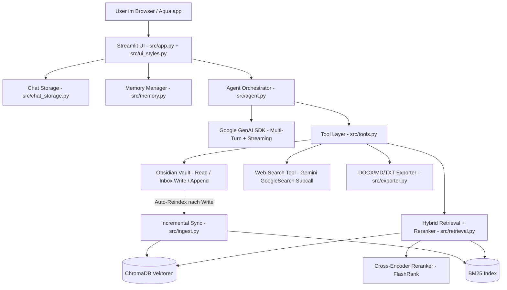

# Architektur- & Umsetzungsplan V2: Aqua – Second Brain AI-Architect

> **Zweck dieses Dokuments:** Vollständige, direkt ausführbare technische Spezifikation für die Weiterentwicklung von **Aqua (V1 → V2)**. Alle Dateipfade, Datenstrukturen, Funktionssignaturen, Schnittstellen, UI-Komponenten, Fehlerbehandlungen und Abnahmekriterien sind so definiert, dass ein Coding-Agent (z. B. GitHub Copilot) jede Phase ohne Rückfragen abarbeiten kann.

---

## 1. Ist-Zustand-Analyse (V1 Audit)

### 1.1 Bestehende Projektstruktur & Abhängigkeiten

Aktuelle Dateien im Repository:
- [`requirements.txt`](requirements.txt): `google-genai>=1.0,<4.0`, `chromadb>=1.3,<2.0`, `streamlit>=1.40,<2.0`, `python-dotenv>=1.0,<2.0`, `python-docx>=1.1,<2.0` (Laufzeitumgebung: Python 3.13 in `.venv`, installiert u. a. `google-genai==3.6.1`, `chromadb==1.5.9`, `streamlit==1.67.0`, `onnxruntime==1.32.0`).
- [`src/config.py`](src/config.py): Lädt `.env` (`GEMINI_API_KEY`, `GEMINI_MODEL`, `OBSIDIAN_VAULT_PATH`, `DEFAULT_SAVE_FOLDER`), validiert Lesezugriff auf das Obsidian-Vault (inkl. Google-Drive-Mount-Prüfung).
- [`src/ingest.py`](src/ingest.py): Rekursiver Scan von `.md`-Dateien (ignoriert `.obsidian`, `.trash`, `.copilot`, `.smart-env`, `.opencode`, `anhaenge`, `anhänge`, `attachments` und versteckte Ordner), Chunking nach Überschriften `#{1,3}` und Absätzen (`max_chars=800`, `overlap=100`), Incremental Sync über `sync_state.json` (`mtime`-Vergleich), Embeddings über `gemini-embedding-001` und Speicherung in ChromaDB (`chroma_db/`, Collection `obsidian_markdown`).
- [`src/tools.py`](src/tools.py): `sanitize_filename()`, `propose_note_save()`, `execute_note_save()`, `create_downloadable_file()`, `search_vault()` (rein semantische Vektor-Abfrage mit `n_results=5`), `build_generate_content_config()`, `build_two_step_configs()`.
- [`src/exporter.py`](src/exporter.py): `markdown_to_docx()` konvertiert Überschriften (`#`–`###`), Bullet-/nummerierte Listen, Code-Blöcke und `**bold**` in einfache `.docx`-Dateien unter `exports/`.
- [`src/chat_storage.py`](src/chat_storage.py): Persistiert Chats als JSON in `chats/<uuid>.json` mit `id`, `title`, `created_at`, `updated_at`, `messages` (`role`, `content`, `timestamp`), `sources`.
- [`src/app.py`](src/app.py): Streamlit-UI mit Sidebar (Chat-Liste, Fokus-Radio, Modell-Selectbox, Sync-Button), Chat-Verlauf, `st.chat_input(accept_file=True)`, Gemini-Aufruf (`generate_gemini_reply`), globaler Quellen-Expander und Save-/Download-Buttons.
- [`aqua-start.command`](aqua-start.command) & [`aqua-stop.command`](aqua-stop.command): macOS-Start-/Stoppskripte für `streamlit run src/app.py` auf `127.0.0.1:8501`.

### 1.2 Aktueller Datenfluss & identifizierte Engpässe / Bugs in V1

| Bereich | Aktueller V1-Ablauf | Identifizierte Mängel & Ursachen in V1 |
|---|---|---|
| **Ingestion** | `src/ingest.py` existiert als CLI, wird in `src/app.py` aber **nie** ausgeführt (`mock_sync()` prüft nur `detect_vault_changes()` ohne Embeddings zu schreiben). | `chroma_db/` bleibt leer (`0` Chunks). `embed_texts()` sendet außerdem alle Chunks in einem einzigen API-Call ohne Batch-Limit (fehlschlägt bei großen Erst-Syncs >100 Chunks). Chunks enthalten keinen Dokumenttitel-/Überschriftenpfad als Kontext. |
| **Retrieval** | `search_vault()` führt nur eine einfache Top-5 Vektor-Suche auf `obsidian_markdown` aus. In `app.py` wird `search_vault()` im Tool-Fallback nicht einmal aufgerufen, sondern durch einen naiven Keyword-Scan (`file_text.casefold().count(term)`) über Rohdateien ersetzt. | Keine Keyword-Suche (BM25) für exakte Fachbegriffe/Namen/Kürzel; kein Reranking der Kandidaten; bei `vault_markers` im Prompt wird blind auf Dateinamen/Substring-Treffer ausgewichen. |
| **Generation & Tools** | `generate_gemini_reply()` wählt per Keyword-Liste (`live_request_markers`) entweder `web_config` oder `own_config`, ruft `generate_content()` genau 1× auf und verarbeitet `function_call`s nur rudimentär für `search_vault`. | `propose_note_save` und `create_downloadable_file` werden vom Modell zwar deklariert, aber von `app.py` **niemals ausgeführt** (`pending_save` und `download_files` bleiben leer). `google_search` und eigene Tools schließen sich gegenseitig aus. `focus` wird als Parameter übergeben, aber **nicht** als `system_instruction` genutzt. |
| **Gedächtnis (Memory)** | `history = list(chat_messages or [])[-12:]` wird als einzelner Plain-Text-Block in `parts` geklebt. Im Tool-Follow-up (`contents=follow_up`) wird die History komplett weggelassen. | (1) Harter Cut nach 12 Nachrichten ohne Zusammenfassung → Gedächtnisverlust mitten im Chat. (2) Keine echten Multi-Turn `types.Content(role=..., parts=...)`-Strukturen. (3) Tool-Follow-up verwirft Verlauf und Uploads. (4) Hochgeladene Dateien/Dokumente werden in Folgeturns vergessen. |
| **Word-Export** | `markdown_to_docx()` unterstützt nur Basis-Markdown. | Keine Tabellen, keine Kursivschrift/Inline-Code/Links, keine Dokument-Templates (DIN-5008-Anschreiben, tabellarischer Lebenslauf, professioneller Bericht), keine saubere Typografie/Seitenränder. |
| **UI & Chat-Verwaltung** | Standard-Streamlit-Layout (`st.title`, einfache Sidebar-Buttons, globale `used_sources` und `download_files`). | Kein modernes ChatGPT/Gemini-Look-&-Feel, kein Streaming, keine Live-Tool-Statusanzeige, keine per-Message Quellen/Downloads, **kein Löschen von Chats**, **keine temporären Chats**. |

---

## 2. Ziel-Architektur V2

### 2.1 Systemübersicht (Datenfluss)



### 2.2 Ziel-Dateistruktur V2

Neue Dateien sind mit `[NEU]`, überarbeitete Dateien mit `[UPDATE]` markiert:

```text
RAG_Obsidian_Ai/
├── .env                          # Erweitert um optionale V2-Defaults (s. Abschnitt 3.1)
├── .gitignore                    # Zusätzlich: .pytest_cache/, ggf. bm25_index*
├── .streamlit/
│   └── config.toml               # [NEU] Modernes Base-Theme (Dark/Minimalist), Toolbar-Config
├── requirements.txt              # [UPDATE] + rank-bm25, flashrank, pytest
├── Plan.md                       # Bestehend (unverändert als V1-Referenz)
├── planV2.md                     # Dieser V2-Bauplan
├── aqua-start.command            # Unverändert kompatibel
├── aqua-stop.command             # Unverändert kompatibel
├── chroma_db/                    # Bestehende Vektor-DB + bm25_index.json (gitignored)
├── exports/                      # Generierte .docx, .md, .txt (gitignored)
├── chats/                        # Persistente Chats (gitignored; keine Einträge für temp chats)
├── src/
│   ├── __init__.py               # [NEU] Sauberes Package-Init
│   ├── config.py                 # [UPDATE] V2-Config-Felder & sichere Defaults
│   ├── ingest.py                 # [UPDATE] Batch-Embeddings, Heading-Context, BM25-Index-Build, Single-File-Reindex
│   ├── retrieval.py              # [NEU] Stufe 1+2: Hybrid Search (Chroma + BM25 + RRF) & Cross-Encoder Reranking
│   ├── memory.py                 # [NEU] Rolling Summary, Pinned Facts, Attachment-Carryover, Content-Builder
│   ├── tools.py                  # [UPDATE] Vault Search/Read/List, Inbox/Note Write-Back, Web-Search-Tool, Export-Tool
│   ├── agent.py                  # [NEU] Multi-Turn Agentic Tool-Loop + Streaming + System-Instructions
│   ├── exporter.py               # [UPDATE] Profi-DOCX (Tabellen, Inline-Styles, Anschreiben- & Lebenslauf-Templates)
│   ├── chat_storage.py           # [UPDATE] delete_chat, rename_chat, memory-Feld, is_temporary-Schutz, per-Message-Metadaten
│   ├── ui_styles.py              # [NEU] Gemini/ChatGPT-inspiriertes CSS, Welcome-Cards, Badges, Layout-Helper
│   └── app.py                    # [UPDATE] Moderne UI, echte Sync-Anbindung, Streaming, Temp-Chats, Chat-Delete
└── tests/                        # [NEU] Automatisierte Mock- & Integrationstests (pytest)
    ├── test_ingest_and_retrieval.py
    ├── test_memory.py
    ├── test_tools_and_inbox.py
    ├── test_exporter.py
    ├── test_chat_storage.py
    └── test_agent_loop.py
```

### 2.3 Neue Abhängigkeiten (`requirements.txt`)

```text
google-genai>=1.0,<4.0
chromadb>=1.3,<2.0
streamlit>=1.40,<2.0
python-dotenv>=1.0,<2.0
python-docx>=1.1,<2.0
rank-bm25>=0.2.2,<1.0
flashrank>=0.2.10,<1.0
pytest>=8.0,<10.0
```

> **Hinweis zu `flashrank` auf Apple Silicon / Python 3.13:** `onnxruntime` und `tokenizers` sind bereits in `.venv` vorhanden. `flashrank` lädt das ONNX-Reranker-Modell beim ersten echten Aufruf in ein lokales Cache-Verzeichnis (Standard: `/tmp` oder Projekt-Cache-Pfad `PROJECT_ROOT / ".cache" / "flashrank"` – besser `chroma_db/reranker_cache` oder `.cache/`, sodass es in `.gitignore` liegt). Falls offline oder `--mock`, greift automatisch der RRF-Fallback ohne Exception.

---

## 3. Detaillierte Technische Spezifikation

### 3.1 Konfiguration (`src/config.py` & `.env`)

Erweitere `Config` in [`src/config.py`](src/config.py) abwärtskompatibel (bestehende `.env`-Dateien mit nur den 4 bisherigen Keys müssen weiter ohne Fehler starten):

```python
@dataclass(frozen=True)
class Config:
    gemini_api_key: str
    gemini_model: str
    obsidian_vault_path: Path
    default_save_folder: str
    inbox_folder: str = "Inbox"
    auto_save_folders: tuple[str, ...] = ("Inbox",)
    export_dir: Path = PROJECT_ROOT / "exports"
    reranker_model: str = "ms-marco-MultiBERT-L-12"
    enable_reranker: bool = True
    memory_summary_threshold: int = 10
    memory_recent_turns: int = 8
```

**Optionale `.env`-Variablen (mit sicheren Defaults, falls nicht gesetzt):**
- `INBOX_FOLDER="Inbox"`
- `AUTO_SAVE_FOLDERS="Inbox"` (komma-separiert; Ordner, in die auf expliziten User-Befehl ohne zusätzlichen Bestätigungs-Button geschrieben werden darf)
- `EXPORT_DIR=""` (falls leer → `PROJECT_ROOT / "exports"`)
- `RERANKER_MODEL="ms-marco-MultiBERT-L-12"` (mehrsprachig für Deutsch + Englisch)
- `ENABLE_RERANKER="true"`

**Wichtige Korrektur gegenüber V1:** `src/app.py` darf nicht mehr blind `"gemini-3.8-flash"` hartcodieren, sondern initialisiert `st.session_state.model` aus `config.gemini_model` (Fallback `"gemini-2.5-flash"` im Mock-/Fehlerfall) und stellt sicher, dass `config.gemini_model` immer in `model_options` enthalten ist.

---

### 3.2 Ingestion, Chunk-Anreicherung & BM25-Index (`src/ingest.py`)

#### Aufgaben & Verbesserungen
1. **Heading-Context-Anreicherung beim Chunking:**
   - Erweitere `MarkdownChunk` um `heading_path: str` (z. B. `"# Projektplan > ## Architektur"`).
   - Speichere in ChromaDB-`metadatas` zusätzlich `"heading_path": chunk.heading_path`.
   - Präfixe den eingebetteten/gespeicherten Chunk-Text mit `[Datei: <relative_path> | Abschnitt: <heading_path>]\n\n<chunk_text>` (oder speichere ihn als Such-Kontext), damit Vektor- und BM25-Suche immer Dateinamen, Ordnerkategorie und Überschriftenkontext mit matchen.
2. **Batching in `embed_texts()`:**
   - Gemini `embed_content` in Batches von maximal `batch_size = 50` Texten aufrufen (mit einfacher Exponential-Backoff-Retry-Logik bei transienten `429`/`503`-Fehlern, max. 3 Versuche).
3. **BM25-Korpus & Index-Persistenz:**
   - Nach jedem `ingest`-Lauf (oder Single-File-Update) wird ein leichtgewichtiger JSON-Korpus unter `PROJECT_ROOT / "chroma_db" / "bm25_corpus.json"` aktualisiert (enthält pro Chunk: `id`, `text`, `path`, `category`, `filename`, `heading_path`, `chunk_index`, `last_modified`).
   - Vorteil: Kein unsicheres `pickle`, direkt inspizierbar, durch `.gitignore` (`chroma_db/`) geschützt, und `src/retrieval.py` baut daraus mit `rank_bm25.BM25Okapi` in Millisekunden (und via `@st.cache_resource` gecacht) den BM25-Index.
4. **Programmatische Sync-API für UI & Write-Back:**
   - Neue Funktion `sync_vault(vault_path: Path | None = None, api_key: str | None = None, mock: bool = False) -> SyncResult` (Dataclass mit `total_files`, `changed_files`, `deleted_files`, `chunks_embedded`, `changed_paths`, `errors`).
   - Neue Funktion `reindex_single_file(file_path: Path, vault_path: Path, api_key: str | None = None, mock: bool = False) -> int`: Aktualisiert nach `write_vault_note()` sofort gezielt genau diese eine Datei in ChromaDB, `bm25_corpus.json` und `sync_state.json`, ohne das gesamte Vault neu zu scannen!
5. **Echte Sync-Integration in `app.py`:**
   - Entferne `mock_sync()` als alleinigen UI-Handler.
   - Im Live-Modus (`api_key` vorhanden) ruft der Auto-Sync beim Session-Start und der Button „Vault jetzt synchronisieren“ `sync_vault(mock=False)` auf (mit `st.spinner` / Toast). Im Mock-Modus wird `sync_vault(mock=True)` ausgeführt.

---

### 3.3 Hybrid Search & Cross-Encoder Reranking (`src/retrieval.py`)

Dieses Modul setzt **Stufe 1 (Reranking)** und **Stufe 2 (Hybrid Search: BM25 + Vektoren)** um.

#### Tokenizer für BM25
```python
def tokenize_for_bm25(text: str) -> list[str]:
    # Kleinbuchstaben, behält alphanumerische Tokens inkl. Bindestriche/Unterstriche/Umlaute
    # Beispiel: "MOD-104", "System_Engineering", "gemini-2.5-flash" werden als Ganzes UND Teile tokenisiert
```
- Wichtig für deutsche Obsidian-Notizen und Fachkürzel: Sowohl zusammengesetzte Token (`system_engineering`, `cs-101`) als auch Teilwörter (`system`, `engineering`, `cs`, `101`) indizieren.

#### Reciprocal Rank Fusion (RRF)
1. **Vector Search (ChromaDB):**
   - Query-Embedding via `embed_texts([query], api_key)[0]`.
   - Hole `top_k_dense = 20` (bzw. `min(20, collection.count())`, bei `count == 0` leere Liste ohne Crash!).
   - Unterstützt optional `folder_filter` (`category` in ChromaDB `where`-Filter).
2. **Keyword Search (BM25):**
   - Filtert `bm25_corpus.json` vorab nach `folder_filter` (falls gesetzt) oder bewertet das gesamte Korpus.
   - Holt `top_k_sparse = 20` Dokumente mit `bm25_score > 0`.
3. **Fusion (RRF):**
   - Für jedes eindeutige Chunk (`chunk_id` = `relative_path:chunk_index`):
     $$\text{rrf\_score} = \frac{w_{\text{dense}}}{60 + \text{rank}_{\text{dense}}} + \frac{w_{\text{sparse}}}{60 + \text{rank}_{\text{sparse}}}$$
     Standardgewichte: `w_dense = 1.0`, `w_sparse = 1.0`.
   - Sortiere absteigend nach `rrf_score` und wähle die **Top-15 Kandidaten** (`rerank_pool_size = 15`).

#### Stufe 1: Cross-Encoder Reranking
- Funktion `rerank_candidates(query: str, candidates: list[RetrievalResult], top_n: int = 5, model_name: str = ..., enabled: bool = True) -> list[RetrievalResult]`:
  - Nutzt `flashrank.Ranker(model_name=model_name, cache_dir=str(PROJECT_ROOT / "chroma_db" / "reranker_cache"))` (Singleton/gecacht über `@lru_cache` / Modul-Cache, damit das ONNX-Modell nicht pro Suchanfrage neu geladen wird).
  - Bewertet die Top-15 Kandidaten paarweise gegen `query` und liefert die **Top-`top_n` (Standard `5`, für fokussierte Queries `3–5`)** mit `rerank_score` (0.0–1.0) und `retrieval_method = "hybrid+rerank"`.
  - **Resilient Fallback:** Schlägt `flashrank` fehl (z. B. fehlendes lokales Cache-Modell ohne Internet oder `enabled=False` oder `mock=True`), fällt `rerank_candidates` sauber auf die Top-`top_n` nach `rrf_score` zurück (`retrieval_method = "hybrid_rrf"`), ohne den Chat abzubrechen.

#### Öffentliche Schnittstelle
```python
@dataclass(frozen=True)
class RetrievalResult:
    chunk_id: str
    text: str
    filename: str
    path: str
    category: str
    heading_path: str
    score: float
    retrieval_method: str  # "hybrid+rerank" | "hybrid_rrf" | "bm25_only" | "mock"

def hybrid_search_and_rerank(
    query: str,
    folder_filter: list[str] | None = None,
    top_n: int = 5,
    pool_size: int = 15,
    mock: bool = False,
) -> list[RetrievalResult]: ...
```

---

### 3.4 Gedächtnis-Optimierung / Memory Manager (`src/memory.py`)

Behebt das Problem, dass der Bot mitten im Chat den roten Faden oder hochgeladene Dokumente verliert.

#### Erweiterte Chat-Struktur in `chat_storage.py`
Jeder Chat erhält ein optionales `memory`-Objekt (bei alten V1-JSONs beim Laden automatisch mit Defaults ergänzt):
```json
{
  "memory": {
    "summary": "",
    "pinned_facts": [],
    "summarized_until_index": 0,
    "active_artifacts": []
  }
}
```
Jede Nachricht in `chat["messages"]` kann zusätzlich speichern:
```json
{
  "role": "user" | "assistant",
  "content": "...",
  "timestamp": "...",
  "sources": [],
  "downloads": [],
  "saved_notes": [],
  "attachments_context": ""
}
```
- `attachments_context`: Kompakte Zusammenfassung/Textauszug der in diesem Turn hochgeladenen Dateien (`.pdf`, `.docx`, `.txt`, `.md`, `.csv` oder Kurzbeschreibung bei Bildern, max. z. B. 2500 Zeichen pro Turn), damit Folgefragen den Dateiinhalt später weiterhin im Konversationsverlauf haben!

#### 3-Stufen-Kontextaufbau (`build_conversation_contents`)
1. **System Instruction (`build_system_instruction`):**
   Enthält immer:
   - Rolle & Verhaltensregeln von **Aqua** (Antwortsprache Deutsch, präzise, ehrlich bei Unsicherheit, kein Erfinden von Vault-Inhalten).
   - Aktives **Fokus-Profil** (mit Ordner-Priorisierung):
     - `"Allrounder"`: Voller Zugriff auf gesamtes Vault, Websuche, eigenes Wissen.
     - `"System-Engineering & Projekt-Architekt"`: Priorisiere `folder_filter=["System_Engineering", "Studium", "Projekte", "Prompts"]` bei `search_vault`.
     - `"Interview- & Reflexions-Coach"`: Priorisiere `folder_filter=["Inbox", "Projekte"]`, ehrliches Feedback, STAR-Struktur.
   - **Vault-Schreibregeln:** Erklärt genau, wann `write_vault_note(..., auto_confirm=True)` (bei explizitem User-Befehl für `Inbox` / erlaubte Ordner) vs. `propose_note_save(...)` (bei proaktiven Vorschlägen oder anderen Ordnern) genutzt werden soll.
   - **Word-Export-Regeln:** Erklärt die `doc_style`-Werte (`standard`, `cover_letter`, `cv`) für `create_downloadable_file`.
   - **Langzeitgedächtnis dieses Chats:**
     - `Bisherige Gesprächszusammenfassung: <chat["memory"]["summary"]>` (falls nicht leer)
     - `Wichtige Fakten / Rahmenbedingungen: <pinned_facts>` (falls nicht leer)
     - `Zuletzt erstellte Dateien/Notizen: <active_artifacts>` (z. B. Dateiname des gerade generierten Lebenslaufs oder der Inbox-Notiz, damit der User sagen kann „Ändere dort noch Absatz 2“!)
2. **Rolling Summarization (`maybe_compress_memory`):**
   - Prüft vor dem LLM-Aufruf, ob `len(messages) - summarized_until_index > config.memory_summary_threshold` (Standard: `10`) oder die geschätzte Zeichen-/Tokenlänge der unkomprimierten älteren Nachrichten `> 18_000` Zeichen liegt.
   - Behält immer die letzten `config.memory_recent_turns` (Standard: `8`) Nachrichten im **Original-Wortlaut**.
   - Alle dazwischenliegenden älteren Nachrichten (`messages[summarized_until_index : -recent]`) werden gemeinsam mit der bisherigen `summary` durch einen strukturierten Prompt an das schnelle Flash-Modell zusammengefasst (Rückgabeformat JSON mit `summary`, `pinned_facts`, `active_artifacts`).
   - Im Mock-Modus oder bei API-Fehler greift ein deterministischer Extraktor (nimmt User-Fragen + erste Sätze der Antworten), sodass `summarized_until_index` trotzdem sauber arbeitet bzw. nichts abstürzt.
3. **Echte Multi-Turn `types.Content`-Liste:**
   - Wandelt `recent_messages` in echte `google.genai.types.Content(role="user" | "model", parts=[...])`-Objekte um (inkl. `attachments_context` an den jeweiligen User-Turns).
   - **Wichtig:** Diese `contents`-Liste wird in der gesamten Agent-Tool-Schleife fortgeführt (wenn Gemini Tool Calls ausgibt, wird der `model`-Content mit `function_call` angehängt und danach ein `user`-Content mit `function_response`), sodass **niemals** Kontext während Tool-Aufrufen verloren geht!

---

### 3.5 Agentic RAG, Tool-Loop & Obsidian-Inbox-Automatisierung (`src/tools.py` & `src/agent.py`)

#### Alle Tools für Gemini (`src/tools.py`)
1. `search_vault(query: str, folder_filter: list[str] | None = None, top_n: int = 5)`
   - Ruft intern `hybrid_search_and_rerank()` auf.
   - Gibt strukturierte Chunks (`path`, `filename`, `category`, `heading_path`, `score`, `text`) als JSON-dict an Gemini zurück **und** protokolliert die genutzten Quellen im aktuellen Turn-Kontext (`TurnToolContext`), nicht mehr in globalem Session-State-Chaos.
2. `read_vault_note(relative_path: str)` *(NEU)*
   - Liest eine komplette `.md`-Notiz sicher innerhalb `OBSIDIAN_VAULT_PATH` (Path-Traversal-geschützt, max. z. B. 20.000 Zeichen mit Hinweis bei Kürzung), falls der Agent nach einem Chunk-Treffer den vollen Kontext braucht oder eine Notiz gezielt ergänzen will.
3. `list_vault_folders()` *(NEU)*
   - Listet alle Top-Level- und 2.-Ebene-Ordner im Vault (ohne versteckte/System-Ordner), damit der Agent echte Ordnernamen kennt.
4. `write_vault_note(content: str, filename: str, target_folder: str = "Inbox", mode: str = "create", auto_save: bool = False)` *(NEU / ersetzt unsicheres `execute_note_save`-Tool-Exposure)*
   - **Wann direkt speichern (`auto_save=True`):**
     Nur erlaubt, wenn `target_folder` (Top-Level-Ordner) in `config.auto_save_folders` liegt (Standard: `("Inbox",)`) **und** im User-Prompt bzw. Agent-Kontext ein expliziter Schreib-/Speicherbefehl vorliegt (`user_explicitly_requested_write=True`, geprüft über Intent/Prompt-Marker oder expliziten UI-Schalter „Auto-Save in Inbox erlauben“).
     - Unterstützt drei Modi:
       - `"create"` (Standard): Erzeugt neue `.md`-Datei; bei Namenskollision wird automatisch ein Suffix (`_2` oder Datum-Uhrzeit) angehängt, um versehentliches Überschreiben zu verhindern!
       - `"append"`: Hängt den neuen Inhalt mit Trennlinie `\n\n---\n\n` (oder Zeitstempel-Überschrift) an eine bestehende Notiz (z. B. `Inbox/Quick-Notes.md`) an.
       - `"overwrite"`: Nur bei explizitem Update-Wunsch auf existierenden Pfad.
     - **Sofortiges Re-Indexing:** Ruft direkt `reindex_single_file()` auf, damit die neue Inbox-Notiz ab sofort in ChromaDB + BM25 durchsuchbar ist!
   - **Wann Bestätigung erforderlich (`auto_save=False` oder Ordner außerhalb `auto_save_folders`):**
     Erstellt ein `NoteSaveProposal`, speichert es in `TurnToolContext.pending_saves` und liefert an Gemini zurück: `"status": "pending_confirmation", "message": "Vorschlag erstellt; der Nutzer muss in der UI bestätigen."` → Der User sieht direkt unter der Nachricht eine Vorschau-Karte mit „In Vault speichern“ / „Abbrechen“.
   - `execute_note_save()` bleibt als reine UI-Backend-Funktion in `src/tools.py` erhalten (wird **nicht** mehr als LLM-FunctionDeclaration exponiert, damit das Modell Bestätigungen niemals selbst umgehen kann).
5. `web_search(query: str)` *(NEU – löst das V1-Combined-Tools-Problem elegant!)*
   - Python-Tool-Wrapper um Geminis Built-in `types.GoogleSearch()`:
     Ruft `client.models.generate_content(model=..., contents=query, config=types.GenerateContentConfig(tools=[types.Tool(google_search=types.GoogleSearch())]))` auf, extrahiert Antworttext + `grounding_metadata.grounding_chunks` (Titel + URL) und loggt Web-Quellen in `TurnToolContext.web_sources`.
   - **Riesenvorteil:** Das Hauptmodell benötigt in `GenerateContentConfig` nur noch **einheitliche Python `function_declarations`** und kann in **einem einzigen** Multi-Step-Loop `search_vault`, `web_search`, `write_vault_note` und `create_downloadable_file` beliebig kombinieren! Der fragile `live_request_markers`-Workaround aus V1 entfällt komplett.
6. `create_downloadable_file(content: str, filename: str, file_type: str = "docx", doc_style: str = "standard")`
   - Erstellt `.docx`, `.md` oder `.txt` in `exports/`, loggt den Pfad in `TurnToolContext.download_files` (und in `memory.active_artifacts`) und gibt an Gemini `{ "status": "created", "filename": ..., "path": ... }` zurück.

#### Agent-Loop & Streaming (`src/agent.py`)
```python
def run_agent_turn(
    prompt: str,
    chat: dict[str, Any],
    focus: str,
    model_name: str,
    uploads: list[Any],
    config: Config,
    allow_auto_inbox_write: bool = True,
    on_status: Callable[[str], None] | None = None,
    mock: bool = False,
) -> AgentTurnResult
```
**Ablauf von `run_agent_turn`:**
1. Anhänge verarbeiten (`uploads`): Bilder/PDFs als `types.Part.from_bytes` + Textextrakte (`.txt`, `.md`, `.csv`, `.docx`) für den aktuellen Turn; kompakte Zusammenfassung in `attachments_context` sichern.
2. `maybe_compress_memory()` ausführen, falls das Chat-Gedächtnis komprimiert werden muss.
3. `system_instruction` und `contents` (Multi-Turn History + aktueller User-Turn) über `src/memory.py` bauen.
4. **Iterative Tool-Schleife (`max_iterations = 6`):**
   - `on_status("Denke nach…")`
   - `response = client.models.generate_content(model=model_name, contents=contents, config=agent_config)`
   - Prüfe auf `function_call`-Parts in `response.candidates[0].content.parts`:
     - Falls vorhanden: `response.candidates[0].content` an `contents` anhängen; jedes Tool ausführen (mit passender Statusmeldung, z. B. `"Durchsuche Obsidian-Vault (Hybrid + Rerank)…"`, `"Schreibe in Inbox…"`, `"Erstelle Word-Dokument…"`), Ergebnisse als `types.Content(role="user", parts=[types.Part.from_function_response(...)])` an `contents` anhängen und nächste Runde starten.
     - Falls **keine** `function_call`s mehr vorliegen: Finale Textantwort übernehmen (oder falls Modell leer antwortete, genau 1× mit klarer Text-Aufforderung nachgenerieren).
5. **Streaming-Ausgabe in der UI:**
   - Variante A (robust & sofort umsetzbar): Tool-Runden laufen innerhalb `st.status(..., expanded=True)` mit Live-Schritten (`st.write(...)`); sobald die finale Antwort ohne Tool-Calls generiert wird (oder direkt via `client.models.generate_content_stream` im finalen Answer-Step, wenn keine Tools mehr nötig sind), wird der Text mit `st.write_stream()` flüssig gestreamt.
   - Falls `generate_content_stream` bereits in der Schleife genutzt wird: Chunks ohne `function_call` direkt yielden, bei `function_call` Status aktualisieren und Tool ausführen. *(Empfehlung für maximale Zuverlässigkeit mit `google-genai`: Non-streaming Tool-Decision-Steps + Streaming im finalen Synthesis-Step bzw. flüssiges Chunk-Yielding bei reinen Textantworten.)*
6. Rückgabe `AgentTurnResult(reply_text, obsidian_sources, web_sources, download_files, pending_saves, saved_notes, attachments_context)`.

---

### 3.6 Professioneller Word-Dateien-Generator (`src/exporter.py`)

Ermöglicht hochwertige `.docx`-Dokumente speziell auch für **Anschreiben**, **Lebensläufe (CV)**, **Projektpläne** und **Berichte**.

#### Unterstützte `doc_style`-Profile
1. **`"standard"` (Berichte, Projektpläne, Zusammenfassungen):**
   - Schriftart: `Calibri` (11 pt, Zeilenabstand 1.15, Absatzabstand nachher 6 pt), Ränder 2.5 cm.
   - Klare Überschriften-Hierarchie (`#` 18 pt fett dunkelblau/anthrazit, `##` 14 pt, `###` 12 pt).
2. **`"cover_letter"` (Anschreiben / DIN-5008-orientiert):**
   - Seitenränder: Links 2.5 cm, Rechts 2.0 cm, Oben 2.0 cm, Unten 2.0 cm.
   - Erkennt spezielle Markdown-Abschnitte bzw. Konventionen (oder strukturierte Blöcke vor dem ersten `---` / Betreff):
     - Absenderzeile / Kontaktdaten oben
     - Empfängeradresse
     - Rechtsbündiges Datum
     - **Fetter Betreff** (über `**Betreff: ...**` oder `# ...`)
     - Sauber formatierter Brieftext (11 pt, keine unnötigen Überschriften-Abstände), Grußformel & Signaturbereich.
3. **`"cv"` (Lebenslauf / Resume):**
   - Kompaktere Ränder (1.8 cm – 2.0 cm), moderne Überschriften mit dezenter unterer Rahmenlinie (XML-Border unter `##`-Abschnitten wie `Berufserfahrung`, `Ausbildung`, `Kenntnisse`).
   - **Tabellen-Unterstützung (`| Zeitraum | Station |`):** Markdown-Tabellen im CV-Stil werden als saubere, rahmenlose 2-Spalten-Layout-Tabellen gerendert (linke Spalte schmal für Zeiträume/Labels ~28 %, rechte Spalte breit für Position, Unternehmen und Bullet-Points ~72 %), während Tabellen im `"standard"`-Stil sichtbare dezente Gitternetzlinien + graue Kopfzeile erhalten!

#### Erweiterte Markdown-Features in `markdown_to_docx(markdown_text, filename, doc_style="standard")`
- Überschriften `#` bis `####`
- Inline-Formatierung über einheitlichen Inline-Parser: `**fett**`, `*kursiv*`, `` `inline code` ``, `[Link-Text](URL)` (rendert Text + URL sauber oder als Hyperlink)
- Markdown-Tabellen (`| A | B |` mit `|---|---|` Separator)
- Code-Blöcke (```` ```lang ... ``` ````) mit Monospace (`Courier New` / `Menlo` 9 pt) und dezenter Hintergrund-Schattierung (`w:shd`)
- Blockquotes (`> ...`) mit linker Einrückung & dezentem linkem Randbalken
- Horizontale Trennlinien (`---`, `***`) als dezente Absatz-Unterlinie
- Kollisionsfreie Dateinamen optionierbar bzw. sauber sanitisiert über `sanitize_filename()`.

---

### 3.7 Chat-Persistenz, Löschen & Temporäre Chats (`src/chat_storage.py`)

#### Neue & aktualisierte Funktionen
1. **`create_chat(title=None, messages=None, sources=None, is_temporary=False)`:**
   - Legt Schema mit `id`, `title`, `created_at`, `updated_at`, `is_temporary`, `messages`, `sources`, `memory` (`summary`, `pinned_facts`, `summarized_until_index`, `active_artifacts`) an.
2. **`save_chat(chat, chats_dir=None) -> str | None`:**
   - **Harter Schutz für temporäre Chats:** Wenn `chat.get("is_temporary")` truthy ist, wird **sofort `None` zurückgegeben** und **keine** Datei unter `chats/` geschrieben!
3. **`delete_chat(chat_id: str, chats_dir=None) -> bool`:**
   - Validiert `chat_id` gegen Path-Traversal (`chat_path.parent == target_dir.resolve()`).
   - Löscht `<chat_id>.json` (gibt `True` zurück wenn gelöscht, `False` falls nicht vorhanden).
4. **`delete_all_chats(chats_dir=None) -> int`:**
   - Löscht alle `.json`-Dateien in `chats/` und gibt Anzahl zurück (für optionale Sidebar-Aktion mit Bestätigung).
5. **`rename_chat(chat_id: str, new_title: str, chats_dir=None) -> dict`:**
   - Aktualisiert Titel (max. 80 Zeichen, nicht leer) und `updated_at`, speichert sauber ab.
6. **`load_chat()` Abwärtskompatibilität:**
   - Migriert ältere V1-Chat-JSONs beim Laden on-the-fly im Speicher (ergänzt fehlendes `memory`-Dict, `is_temporary=False`, optionale Message-Felder `sources=[]`, `downloads=[]`, `saved_notes=[]`).
7. **`add_message(...)` Erweiterung:**
   - Akzeptiert optionale Felder `sources`, `downloads`, `saved_notes`, `attachments_context` direkt auf der Message-Ebene, damit jede Assistant-Antwort ihre eigenen Quellen, Download-Buttons und Vault-Save-Vorschläge dauerhaft behält – auch nach Reload eines alten Chats!

---

### 3.8 Moderne Benutzeroberfläche à la Gemini / ChatGPT (`src/app.py`, `.streamlit/config.toml`, `src/ui_styles.py`)

#### Designprinzipien (Gemini / ChatGPT Look & Feel in Streamlit)
1. **Theme & Layout (`.streamlit/config.toml` + `src/ui_styles.py`):**
   - Dunkles, ruhiges Farbschema (z. B. Deep Slate/Charcoal `#0F1117` Hintergrund, `#171A21` Sidebar, `#1E222D` Elevated Cards/User-Bubble, weicher Akzent `#4F8BF9` / `#7C9BFF`).
   - Versteckt Streamlit-Boilerplate (`#MainMenu`, `footer`, überflüssige Ränder) via CSS, behält aber Sidebar-Toggle sauber sichtbar.
   - Begrenzte Lese-Breite (`max-width: 860px` zentriert im Hauptbereich) wie bei ChatGPT und Gemini, sodass lange Antworten angenehm lesbar bleiben.
2. **Header-Leiste (kompakt & modern):**
   - Zeigt Modell-Pill/Dropdown, Fokus-Pill und bei aktivem temporären Chat ein klares Badge `🕶️ Temporärer Chat (wird nicht gespeichert)` inkl. Button zum Beenden/Zurückwechseln.
3. **Sidebar (aufgeräumt & funktional):**
   - Oben: Primärer Button **`+ Neuer Chat`** und daneben Icon/Button **`Temporärer Chat`** (`use_container_width=True`).
   - Suchfeld `Chats durchsuchen…` (filtert Titel clientseitig).
   - **Chronologisch gruppierte Chat-Liste** (`Heute`, `Gestern`, `Letzte 7 Tage`, `Älter`):
     - Aktiver Chat visuell hervorgehoben.
     - Pro Chat ein kleines `st.popover("⋯")` (oder kompaktes Action-Icon) mit **Umbenennen** (Text-Input + Speichern) und **Löschen** (löscht sofort via `delete_chat()`, wechselt bei Bedarf auf einen neuen leeren Chat + `st.toast("Chat gelöscht")`).
   - Unten (sauber abgetrennt / Expander `Einstellungen & Vault`):
     - Fokus-Auswahl (`Allrounder`, `System-Engineering & Projekt-Architekt`, `Interview- & Reflexions-Coach`).
     - Gemini-Modell-Auswahl (`st.selectbox`).
     - Toggle: `Direktes Speichern in Inbox auf Befehl` (Standard: `True`).
     - Vault-Sync-Status (`X Notizen / Y Chunks indexiert`) + Button `Vault jetzt synchronisieren`.
4. **Empty State / Welcome Screen (wenn `len(chat["messages"]) == 0`):**
   - Zentrierte Begrüßung (`"Hallo! Womit starten wir heute?"` + kurzer Subtext ob normaler oder temporärer Chat aktiv ist).
   - **4 klickbare Quick-Prompt-Karten** (in 2×2 Grid mit `st.columns(2)`):
     1. *„Durchsuche mein Second Brain nach …“*
     2. *„Notiere das in meiner Obsidian Inbox: …“*
     3. *„Erstelle mir ein Anschreiben / einen Lebenslauf als Word-Datei“*
     4. *„Starte einen Projektplan aus meinen Vault-Notizen“*
     (Klick füllt bzw. startet direkt einen Prompt oder lädt Vorlage).
5. **Nachrichten-Darstellung & Per-Message Interaktionen:**
   - **User-Nachricht:** Rechtsbündige oder dezent umrandete Bubble (`#232836`), optionale Anzeige hochgeladener Dateinamen als kleine Attachment-Chips.
   - **Assistant-Nachricht:** Sauberer linksbündiger Flow (wie Gemini/ChatGPT), während der Generierung **`st.status("Aqua arbeitet…")`** für Live-Tool-Schritte und **`st.write_stream(...)`** für die Antwort.
   - **Direkt unter der jeweiligen Assistant-Nachricht** (persistiert in `message`!):
     - **Quellen-Pills / Expander:** „Obsidian-Quellen (N) & Web-Links (M)“ inkl. Dateiname, Ordner, Abschnitt (`heading_path`) und Relevanz-Score.
     - **Vault-Bestätigungskarte** (falls `pending_saves` an dieser Nachricht hängen): Zeigt Zielpfad (`Vault/Ordner/Datei.md`), kurzen Content-Preview, und Buttons **`✓ Ins Vault speichern`** / **`✕ Verwerfen`** (nach Bestätigung sofort Re-Indexierung + Status-Update auf der Nachricht!).
     - **Auto-Saved Badge** (wenn `write_vault_note` direkt in `Inbox` geschrieben hat): Grünes Info-Banner `✓ Direkt in Obsidian gespeichert: Inbox/<datei>.md (sofort indexiert)`.
     - **Download-Buttons** (für `message["downloads"]`): Schöne Download-Buttons für `.docx`, `.md`, `.txt` direkt unter der Nachricht, die auch nach Browser-Reload / Chat-Wechsel erhalten bleiben!
6. **Composer (`st.chat_input`):**
   - `st.chat_input("Frage stellen, Datei anhängen oder Befehl eingeben (z. B. 'Speichere in Inbox')…", accept_file=True, file_type=[...])` fixiert am unteren Rand.

---

## 4. Phasenplan zur schrittweisen Umsetzung (für GitHub Copilot)

> **Arbeitsanweisung für den Coding-Agenten:** Arbeite die Phasen strikt in dieser Reihenfolge (beginnend mit **Phase 0**) ab. Stelle nach jeder Phase sicher, dass die bestehenden `--mock`-Befehle sowie alle neuen `pytest`-Tests der jeweiligen Phase grün sind, bevor du zur nächsten Phase übergehst.

### Phase 0: V1-Backup & Isolierter V2-Branch (Sicherheitsnetz)
**Ziel:** Den aktuellen V1-Stand komplett unberührt in Git einfrieren, bevor die erste V2-Änderung erfolgt, und alle V2-Arbeiten auf dem eigenen Branch `feat/v2` durchführen.
- **Dateien:** Keine Code-Änderung; reines Git-Branching & Backup.
- **Schritte:**
  - [ ] Prüfe `git status` und stelle sicher, dass **niemals** sensible/ignorierte Dateien (`.env`, `chats/`, `chroma_db/`, `exports/`, `sync_state.json`) gestaged werden.
  - [ ] Stage die offenen V1-Arbeitsstände (`README.md`, `src/app.py`, `aqua-start.command`, `aqua-stop.command`, `docs/screenshots/Obsidian-Vault.png`), falls Änderungen vorliegen, und erstelle einen sauberen Backup-Commit auf dem aktuellen Stand:
    `git commit -m "chore: save V1 stable state before V2"`
  - [ ] Erstelle den geschützten V1-Branch und Tag (`git branch v1-stable`, `git tag v1.0`), ohne V1 jemals später anzufassen.
  - [ ] Wechsle für die gesamte V2-Entwicklung auf einen neuen Branch: `git checkout -b feat/v2`.
  - [ ] Optional für paralleles Testen ohne Branch-Wechsel (nur falls gewünscht): `git worktree add ../RAG_Obsidian_Ai_V1 v1-stable` anlegen.
- **Verifikation:**
  - `git branch -a` zeigt `v1-stable` und aktiven Branch `* feat/v2`.
  - `git log -n 2 --oneline` zeigt den V1-Backup-Commit sauber unter `v1-stable`.
  - Erkläre dem Nutzer kurz in 2 Sätzen, dass V1 unter `v1-stable` gesichert ist und wir jetzt sicher auf `feat/v2` arbeiten.

---

### Phase 1: Fundament, Konfiguration & Ingestion-Upgrade (Hybrid-Vorbereitung)
**Ziel:** Echte Ingestion aus der App heraus nutzbar machen, Batch-Embeddings absichern, Heading-Kontext speichern und BM25-Korpus erzeugen.
- **Dateien:** `requirements.txt`, `.gitignore`, `src/__init__.py`, `src/config.py`, `src/ingest.py`, `tests/test_ingest_and_retrieval.py`
- **Schritte:**
  - [ ] `requirements.txt` um `rank-bm25>=0.2.2,<1.0`, `flashrank>=0.2.10,<1.0`, `pytest>=8.0,<10.0` ergänzen und in `.venv` installieren.
  - [ ] `.gitignore` um `.pytest_cache/` und `.cache/` ergänzen (`chroma_db/` ist bereits enthalten).
  - [ ] `src/__init__.py` anlegen.
  - [ ] `src/config.py`: `Config` um `inbox_folder`, `auto_save_folders`, `export_dir`, `reranker_model`, `enable_reranker`, `memory_summary_threshold`, `memory_recent_turns` mit abwärtskompatiblen Defaults erweitern.
  - [ ] `src/ingest.py`:
    - `MarkdownChunk` um `heading_path: str` erweitern; `chunk_markdown_text` / `chunk_markdown_file` liefern den aktuellen Überschriftenpfad (z. B. `"# Titel > ## Untertitel"`).
    - `embed_texts()` in Batches à maximal 50 Texten aufteilen inkl. Retry (max. 3 Versuche mit Backoff) bei `429`/`503`.
    - `heading_path` in ChromaDB-`metadatas` speichern.
    - Persistenz des BM25-Korpus nach `PROJECT_ROOT / "chroma_db" / "bm25_corpus.json"` implementieren (inkl. atomarer Aktualisierung bei `changed` und `deleted`).
    - `sync_vault(...) -> SyncResult` und `reindex_single_file(...) -> int` implementieren.
    - Bestehenden CLI-Einstieg `python src/ingest.py --mock` erhalten.
- **Verifikation:**
  - `.venv/bin/python src/ingest.py --mock` läuft mit Exit-Code `0`.
  - `pytest tests/test_ingest_and_retrieval.py` (Tests für Heading-Extraktion, Batching-Split, BM25-Korpus-Aufbau & Single-File-Reindex mit Temp-Vault).

---

### Phase 2: Hybrid Search (BM25 + Vektoren + RRF) & Cross-Encoder Reranking
**Ziel:** Stufe 1 & Stufe 2 der RAG-Optimierung sauber in `src/retrieval.py` implementieren.
- **Dateien:** `src/retrieval.py`, `tests/test_ingest_and_retrieval.py`
- **Schritte:**
  - [ ] `tokenize_for_bm25(text: str) -> list[str]` für Deutsch/Englisch inkl. Erhalt und Aufspaltung von Bindestrich-/Unterstrich-Begriffen implementieren.
  - [ ] `RetrievalResult` Dataclass definieren (`chunk_id`, `text`, `filename`, `path`, `category`, `heading_path`, `score`, `retrieval_method`).
  - [ ] BM25-Index-Loader aus `chroma_db/bm25_corpus.json` mit optionalem `folder_filter` implementieren.
  - [ ] Dense-Suche gegen ChromaDB (`n_results=20`, leere Collection sicher abfangen) implementieren.
  - [ ] `reciprocal_rank_fusion(dense_results, sparse_results, k=60, pool_size=15)` implementieren.
  - [ ] `rerank_candidates()` mit `flashrank.Ranker` (Cache-Dir `chroma_db/reranker_cache`, lazy-loaded & gecacht) und resilientem RRF-Fallback bei deaktiviertem Reranker / fehlendem Modell / `--mock` implementieren.
  - [ ] Hauptfunktion `hybrid_search_and_rerank(...)` bereitstellen.
- **Verifikation:**
  - `pytest tests/test_ingest_and_retrieval.py` prüft: (a) exakte Modul-Kürzel werden trotz schwacher Semantik per BM25 gefunden, (b) RRF kombiniert und dedupliziert korrekt, (c) Reranker-Fallback greift fehlerfrei im Mock-/Offline-Test.

---

### Phase 3: Chat-Persistenz V2 (Löschen, Umbenennen, Temporäre Chats, Memory-Schema)
**Ziel:** `src/chat_storage.py` fit machen für Chat-Löschung, Inkognito-/Temporäre Chats, Per-Message-Anhänge/Quellen/Downloads und das Langzeit-Memory-Objekt.
- **Dateien:** `src/chat_storage.py`, `tests/test_chat_storage.py`
- **Schritte:**
  - [ ] `create_chat()` um `is_temporary: bool = False` und `memory: dict` (`summary`, `pinned_facts`, `summarized_until_index`, `active_artifacts`) erweitern.
  - [ ] `save_chat()` gibt `None` zurück und schreibt nichts auf Platte, wenn `chat.get("is_temporary") is True`.
  - [ ] `delete_chat(chat_id, chats_dir=None) -> bool`, `delete_all_chats(chats_dir=None) -> int` und `rename_chat(chat_id, new_title, chats_dir=None) -> dict` mit Path-Traversal-Schutz implementieren.
  - [ ] `load_chat()` & `list_chats()` migrieren V1-JSON-Dateien abwärtskompatibel (ergänzen fehlendes `memory` und `is_temporary=False`).
  - [ ] `add_message()` unterstützt optionale Message-Felder `sources`, `downloads`, `saved_notes`, `pending_saves`, `attachments_context`.
  - [ ] Bestehenden `--mock`-Test in `src/chat_storage.py` erhalten und erweitern.
- **Verifikation:**
  - `.venv/bin/python -m src.chat_storage --mock` erfolgreich.
  - `pytest tests/test_chat_storage.py` prüft Löschen, Umbenennen, Path-Traversal-Abwehr, V1-Migration und Garantie, dass `is_temporary=True` keine JSON-Datei erstellt.

---

### Phase 4: Gedächtnis-Engine (`src/memory.py`)
**Ziel:** Verlustfreien Mehrrunden-Kontext aufbauen (Multi-Turn `Content`-Objekte, Rolling Summary, Pinned Facts, Attachment-Carryover, Fokus-System-Prompt).
- **Dateien:** `src/memory.py`, `tests/test_memory.py`
- **Schritte:**
  - [ ] `build_system_instruction(focus: str, chat: dict, config: Config, allow_auto_inbox_write: bool) -> str` implementieren (inkl. Fokus-Ordner-Regeln, `memory.summary`, `pinned_facts`, `active_artifacts`, Tool-Regeln).
  - [ ] `maybe_compress_memory(chat: dict, config: Config, client: Any | None = None, mock: bool = False) -> bool` implementieren: Komprimiert ältere Turns jenseits der letzten `memory_recent_turns`, aktualisiert `summary`, `pinned_facts`, `summarized_until_index`.
  - [ ] `build_gemini_contents(chat: dict, current_prompt: str, current_parts: list[Any], recent_limit: int = 8) -> list[types.Content]` implementieren: Baut echte `role="user"` / `role="model"` `types.Content`-Listen inkl. `attachments_context` früherer Uploads.
  - [ ] `summarize_attachments_for_memory(uploads: list, extracted_texts: list[str]) -> str` implementieren (kompakter Textauszug, begrenzt auf max. 2500 Zeichen pro Turn).
- **Verifikation:**
  - `pytest tests/test_memory.py` prüft: (a) Kompression ab >10 Nachrichten im Mock-Modus, (b) Beibehaltung der letzten N Nachrichten im Volltext, (c) Erhalt von `attachments_context` in Folgerunden, (d) korrekte Fokus-System-Prompts.

---

### Phase 5: Professioneller Word-/DOCX-Exporter (`src/exporter.py`)
**Ziel:** Hochwertige Word-Dokumente für Anschreiben, Lebensläufe und strukturierte Berichte/Pläne.
- **Dateien:** `src/exporter.py`, `tests/test_exporter.py`
- **Schritte:**
  - [ ] Inline-Formatter erweitern: `**bold**`, `*italic*`, `` `inline code` ``, `[text](url)`.
  - [ ] Tabellen-Parser (`| col1 | col2 |`) für `standard` (mit Gitternetz & Header-Shading) und `cv` (rahmenlose 2-Spalten-Layout-Tabelle).
  - [ ] Blockquotes (`>`), horizontale Trennlinien (`---`), Code-Blöcke mit Schattierung, `####` Level-4-Überschriften.
  - [ ] `doc_style` Parameter (`"standard"`, `"cover_letter"` / `"anschreiben"`, `"cv"` / `"lebenslauf"`) mit passenden Seitenrändern, Schriftgrößen und Absatzabständen implementieren.
  - [ ] Alias-Mapping (`"anschreiben"` → `"cover_letter"`, `"lebenslauf"` → `"cv"`).
  - [ ] `--mock`-CLI-Flag erhalten und um CV/Anschreiben-Test ergänzen.
- **Verifikation:**
  - `.venv/bin/python -m src.exporter --mock` erfolgreich.
  - `pytest tests/test_exporter.py` erstellt echte `.docx`-Dateien in einem Temp-Dir / `exports/`, öffnet sie wieder mit `python-docx` und prüft Tabellen, Stile, Fettdruck, Ränder für `standard`, `cover_letter`, `cv`.

---

### Phase 6: Tools & Agentic-RAG-Orchestrator (`src/tools.py` & `src/agent.py`)
**Ziel:** Vollständige Tool-Ausführung im Multi-Step-Loop, automatisches Schreiben in die Obsidian-`Inbox` auf Kommando (+ sofortiges Re-Indexing) und kombinierte Vault- + Web-Suche.
- **Dateien:** `src/tools.py`, `src/agent.py`, `tests/test_tools_and_inbox.py`, `tests/test_agent_loop.py`
- **Schritte:**
  - [ ] `src/tools.py`:
    - `search_vault()` intern auf `hybrid_search_and_rerank()` umstellen (Abwärtskompatibilität für `mock=True` & bestehende Signatur wahren).
    - `read_vault_note(relative_path, vault_path=None)` mit Path-Traversal-Schutz implementieren.
    - `list_vault_folders(vault_path=None)` implementieren.
    - `write_vault_note(content, filename, target_folder="Inbox", mode="create", auto_save=False, allow_auto_save=True, config=None, vault_path=None)` implementieren:
      - Bei `auto_save=True` **und** `allow_auto_save=True` **und** Ziel-Top-Level-Ordner in `config.auto_save_folders` (Standard `("Inbox",)`): direkt schreiben (bei `"create"` kollisionssicher mit Suffix, bei `"append"` sauber anhängen) + `reindex_single_file()` aufrufen.
      - Sonst: `NoteSaveProposal` für UI-Bestätigung zurückgeben.
    - `create_downloadable_file(..., doc_style="standard")` an `exporter.markdown_to_docx` anbinden.
    - `web_search(query, api_key, model)` als dediziertes Python-Tool mit `types.GoogleSearch()`-Subcall implementieren (extrahiert Antwort + `grounding_metadata` URLs/Titel).
    - `_python_function_declarations()` auf genau diese 6 sauberen Tools aktualisieren (`execute_note_save` **nicht** mehr dem LLM direkt exponieren).
  - [ ] `src/agent.py`:
    - `TurnToolContext` und `AgentTurnResult` Dataclasses definieren.
    - `run_agent_turn(...)` mit Multi-Step-Function-Calling-Schleife (max. 6 Iterationen), Status-Callbacks (`on_status`), lückenloser Übergabe von `contents` über alle Tool-Runden hinweg und optionalem Streaming-Wrapper (`stream_final_reply`) implementieren.
    - Fehlerbehandlung für `429` / `RESOURCE_EXHAUSTED`, Netzwerkfehler und leere Modellantworten sauber kapseln.
- **Verifikation:**
  - `.venv/bin/python -m src.tools --mock` erfolgreich.
  - `pytest tests/test_tools_and_inbox.py tests/test_agent_loop.py` (inkl. Mock-Gemini-Client, der nacheinander `search_vault` → `write_vault_note(target_folder="Inbox", auto_save=True)` → finale Textantwort triggert und sofortige Auffindbarkeit der neuen Inbox-Notiz verifiziert!).

---

### Phase 7: Moderne Gemini/ChatGPT-Style UI (`src/app.py`, `src/ui_styles.py`, `.streamlit/config.toml`)
**Ziel:** Komplettes UI-Upgrade mit modernem Design, Welcome Screen, Sidebar-Chat-Management (Löschen, Umbenennen, Suchen, Zeitgruppen, Temporäre Chats), Streaming, Live-Tool-Status und Per-Message-Quellen/Downloads/Save-Cards.
- **Dateien:** `.streamlit/config.toml`, `src/ui_styles.py`, `src/app.py`
- **Schritte:**
  - [ ] `.streamlit/config.toml` anlegen (modernes Dark-Theme, `primaryColor = "#5B8DEF"`, `backgroundColor = "#0F1117"`, `secondaryBackgroundColor = "#171A21"`, `textColor = "#E8EAED"`).
  - [ ] `src/ui_styles.py` erstellen mit sauber gekapseltem Custom CSS (zentrierter Chat-Container `max-width: 860px`, abgerundete User-Bubbles, dezente Sidebar-Buttons, Badge-Klassen für `Temporärer Chat` und `Inbox Auto-Saved`, Welcome-Screen-Karten-Styling).
  - [ ] `src/app.py` komplett auf die neue Architektur umbauen:
    - Initialisierung mit `config.gemini_model` als Default.
    - Auto-Sync beim ersten Session-Start + manueller Sync-Button führen **echtes** `sync_vault()` aus (inkl. Fortschrittsanzeige/Toast).
    - Sidebar: `+ Neuer Chat`, `Temporärer Chat`-Toggle, Suchfeld, nach Datum gruppierte Chat-Liste mit `st.popover("⋯")` (Umbenennen & Löschen), Einstellungen-Expander (Fokus, Modell, Inbox-Auto-Save-Toggle, Vault-Sync).
    - Welcome Screen bei leerem Chat mit 4 klickbaren Starter-Prompts.
    - Banner bei aktivem temporären Chat.
    - Nachrichten-Loop rendert jede Nachricht aus `chat["messages"]` inkl. ihrer eigenen `sources` (Obsidian + Web), `saved_notes`, `pending_saves` (state-sicher per `message_index` / `proposal_id`!) und `downloads` (persistente `st.download_button`s).
    - Neuer User-Turn nutzt `st.status(...)` + `run_agent_turn(...)` + Streaming-Ausgabe, aktualisiert `chat` und ruft `save_chat(chat)` (automatisch No-Op bei temporärem Chat).
- **Verifikation:**
  - Manueller Smoke-Test über `./aqua-start.command` (oder `.venv/bin/streamlit run src/app.py`) im Mock- und Live-Modus:
    1. Neuer Chat + Chat-Löschen + Chat-Umbenennen in Sidebar.
    2. Temporären Chat starten → Nachricht senden → prüfen, dass `chats/` keine neue Datei erhält.
    3. Multi-Turn-Gespräch >12 Nachrichten + Datei-Upload → prüfen, dass Kontext erhalten bleibt.
    4. Befehl „Speichere das in meiner Inbox“ → prüfen, dass `.md`-Datei im Vault-Ordner `Inbox` liegt und sofort im nächsten Turn gefunden wird.
    5. Befehl „Erstelle mir ein Anschreiben / Lebenslauf als Word-Datei“ → prüfen, dass Download-Button direkt an der Antwort erscheint und `.docx` valide in Word/Pages öffnet.
  - Vollständige Test-Suite ausführen: `.venv/bin/pytest -v`.

---

## 5. Guardrails für die Umsetzung

1. **Kein Over-Engineering:** Kein LangChain, kein LlamaIndex. Direktes `google-genai` SDK + `chromadb` + `rank-bm25` + `flashrank` + `python-docx`.
2. **Datenschutz & Git-Hygiene:** `.env`, `chroma_db/`, `chats/`, `exports/`, `sync_state.json`, `.cache/` bleiben in `.gitignore`. Niemals Vault-Inhalte oder API-Keys loggen oder committen.
3. **Abwärtskompatibilität erhalten:**
   - Bestehende Chats in `chats/*.json` aus V1 müssen ohne Fehler geladen und weitergeführt werden können.
   - Bestehende `.env`-Dateien mit nur den 4 V1-Schlüsseln müssen ohne Fehler funktionieren.
   - `aqua-start.command`, `aqua-stop.command` und alle `--mock`-CLI-Flags (`ingest.py`, `exporter.py`, `tools.py`, `chat_storage.py`) müssen weiterhin funktionieren.
4. **Sichere Vault-Schreibzugriffe:** Path-Traversal (`..`) stets blockieren (`resolved_path.relative_to(vault.resolve())`), Kollisionen beim `"create"`-Modus durch Suffix verhindern statt still zu überschreiben.
5. **Keine Code-Duplizierung:** Pfad-Validierung, Filename-Sanitization und Chunk-Erzeugung werden zentral aus `src/tools.py` bzw. `src/ingest.py` wiederverwendet.
